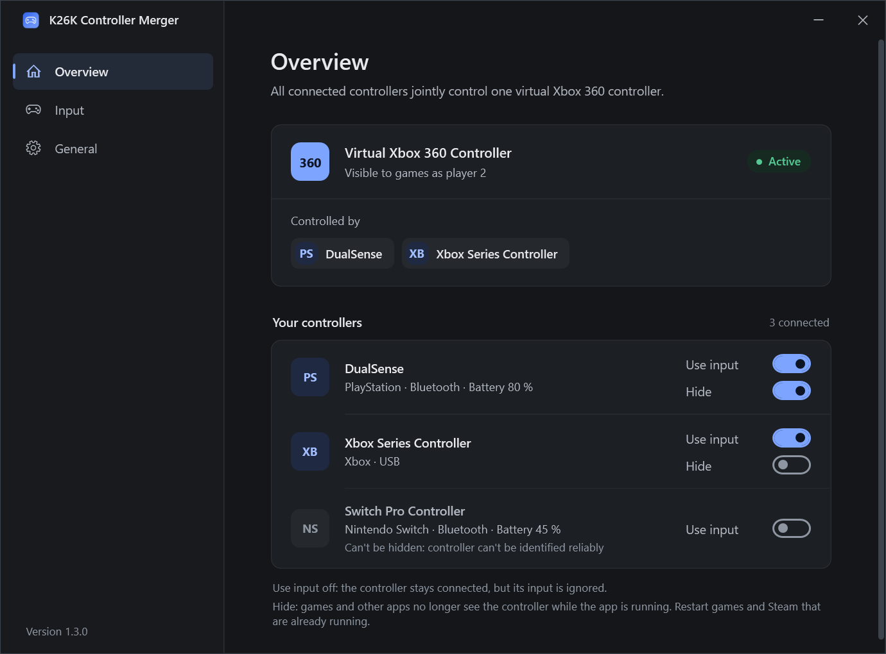

# K26K Controller Merger

**All your gamepads as one single Xbox 360 controller.** K26K Controller Merger permanently creates a virtual Xbox 360 controller through ViGEmBus and merges the input of every connected controller into it. It's ideal for helping a child on a second controller: both of you steer the same character at the same time. And also for moonlight streaming, when you know you know



## Features

- **Always there:** the virtual Xbox 360 controller exists permanently, even when no physical controller is connected.
- **Fully automatic:** new controllers are detected via hot-plug and take effect immediately. No manual assignment needed.
- **True merging:**
  - Buttons: logical OR
  - Triggers: the stronger value wins
  - Analog sticks: largest deflection wins, either per *whole stick* (default) or per *individual axis*
  - D-pad: OR; opposite directions cancel each other out
  - Dead zone for sticks and triggers, applied per controller *before* merging, so drift on an idle controller never wins
- **Rumble** from games is forwarded to all active controllers.
- **Pause individual controllers:** they stay connected but no longer steer.
- **Hide controllers from games:** one switch per controller hides it from games and other apps through [HidHide](https://github.com/nefarius/HidHide) while the app is running, so games only see the merged controller and never react twice. K26K Controller Merger keeps reading hidden controllers. If HidHide is missing, the app installs it on request (pinned version 1.5.230, verified by SHA-256 and digital signature).
- **Supported controllers:** XInput (Xbox 360/One/Series), DualShock 4, DualSense, Switch Pro, Joy-Cons, generic DirectInput/HID gamepads, and Switch 2 controllers (see below).
- **Low latency:** polling every 1, 2, 4 (default) or 8 ms with a high-resolution timer, at about 0.03 % CPU when idle (measured).
- **Tray app:** right-click shows the status, double-click opens the settings. Light and dark mode follow Windows.
- **German and English UI**, switchable live in the settings. The default follows the Windows display language.
- **Autostart** can be turned on in the settings.

## Ideal for Moonlight / Sunshine game streaming

K26K Controller Merger is a natural fit when you stream games from your Windows PC with [Sunshine](https://github.com/LizardByte/Sunshine) (host) to [Moonlight](https://moonlight-stream.org) (client, e.g. on a TV, tablet or handheld):

- **Streamed and local controllers become one.** Sunshine turns every controller connected to a Moonlight client into its own virtual gamepad on the host (Xbox 360 by default). K26K Controller Merger picks these up like any other controller and merges them with the controllers plugged into the PC. Someone in the living room on Moonlight and someone at the PC can then steer the same character together, perfect for helping out without handing over the controller.
- **Single-player games only listen to player 1.** If two Moonlight users (or one streamed and one local controller) play, many games react to only one of them. Because the merged virtual controller is a single device, both inputs reach the game no matter which controller the game picks up.
- **No extra driver.** Sunshine on Windows already uses ViGEmBus for gamepad emulation. If it is installed, the setup wizard detects it and skips the driver installation.
- **Steady controller for the game.** Moonlight clients connect and disconnect while the merged controller stays put. Games don't lose their controller when a streaming session ends or a pad reconnects, and controller order in Windows doesn't matter anymore.
- **Low overhead on the streaming host.** About 0.03 % CPU when idle and a 4 ms default polling interval add practically nothing to encoding load or input latency.

**Tip:** the game may see Sunshine's per-client controllers in addition to the merged one. Turn on **Hide** for them in the overview: games then only see the merged controller, while K26K Controller Merger keeps reading them. Restart a game that was already running so it notices. Note that XInput has 4 slots in total: Sunshine's controllers, local Xbox controllers and the merged controller share them.


## Installation (users)

1. Download `K26KControllerMerger.exe` from the [latest release](../../releases/latest) and put it in a permanent location, e.g. `%LOCALAPPDATA%\Programs\K26K Controller Merger\`. No .NET installation is required.
2. Run it. On **first launch**, a setup wizard checks whether the **ViGEmBus** driver is installed. If it isn't, the wizard
   - downloads it from GitHub (pinned version **1.22.0**),
   - verifies it by **SHA-256 and digital signature** (Nefarius Software Solutions e.U.),
   - installs it with administrator rights (Windows will ask).
3. If Windows asks for a restart, K26K Controller Merger starts again automatically afterwards.
4. Done: the icon appears in the notification area of the taskbar.

If the driver is missing or broken on a later start, a repair view with step-by-step solutions opens.

## Usage

| Action | Result |
|---|---|
| **Right-click** the tray icon | Status popup: virtual controller, connected controllers, quit |
| **Double-click** the tray icon | Settings |
| Starting the EXE a second time | Opens the settings of the running instance |

**Tray icon:**
- Filled green dot: controllers are steering.
- Ring: ready, no active controller.
- Red dot with "!": a problem, e.g. a missing driver.

### Settings

| Page | Options |
|---|---|
| Overview | Virtual controller status, "controlled by", list of all controllers with switches to pause ("Use input") or hide ("Hide") each one |
| Input | Stick merge mode, dead zone (sticks/triggers), invert axes, polling interval |
| General | Forward rumble, start with Windows, color scheme, language (Deutsch/English), technical details (including the HidHide status), help, log file |

Settings are stored in `%APPDATA%\K26KControllerMerger\settings.json`, the log in `%LOCALAPPDATA%\K26KControllerMerger\log.txt`. While controllers are hidden, `%LOCALAPPDATA%\K26KControllerMerger\hidhide.json` records which HidHide entries the app added, so they can be removed reliably.

### Hiding controllers

- Hidden controllers are invisible to games and other apps **only while K26K Controller Merger is running**. Quitting, logging off or shutting down makes them visible again; the next start hides them again.
- Games, Steam and other apps that were already running keep seeing a controller until you restart them.
- The app never hides its own virtual controller and never touches HidHide entries made by you or other tools.
- A controller that can't be identified reliably (for example several pads on one wireless receiver) shows "Can't be hidden" instead of the switch.

## Building (developers)

**Requirements:** Windows 10/11 x64 and the [.NET 10 SDK](https://dotnet.microsoft.com/download).

```bash
dotnet build ControllerMerger.sln
```

```bash
dotnet test tests/ControllerMerger.Tests
```

```bash
dotnet publish src/ControllerMerger -c Release -o artifacts/publish
```

The result is `artifacts/publish/K26KControllerMerger.exe`, a self-contained single-file EXE (≈ 73 MB, compressed) with SDL3 included.

### Developer modes

```bash
K26KControllerMerger.exe --snapshot artifacts/snapshots
```
Renders every screen in light and dark mode to PNG files, without a driver or controllers. This is what the design council reviewed.

```bash
K26KControllerMerger.exe --export-icon src/ControllerMerger/Assets/AppIcon.ico
```
Regenerates the app icon.

### Updating SDL

SDL 3.4.20 (official release, zlib license) is vendored in `lib/SDL3`. To update, change `$Version` and `$Sha256` in `tools/fetch-sdl.ps1` and run:

```bash
powershell -ExecutionPolicy Bypass -File tools/fetch-sdl.ps1
```

## Troubleshooting

| Problem | Solution |
|---|---|
| **A game reacts twice** | The game sees the real controllers in addition to the virtual one. Select the virtual Xbox 360 controller in the game, or turn on **Hide** for the real controllers in the overview and restart the game. |
| A hidden controller still works in a game | The game (or Steam) was already running when you hid it. Restart the game or Steam. |
| "HidHide is busy" | The HidHide configuration app is open. Close it; the app continues automatically. |
| Controllers stay hidden after the app was force-closed | Start K26K Controller Merger again: it cleans up its own HidHide entries on startup. |
| PlayStation/Switch controller not detected while Steam is running | Steam Input or DS4Windows can hold the device exclusively. Disable Steam Input for that device or close the other tool. |
| "The controller driver is not running" | Restart Windows. Then reinstall the driver from the wizard and check whether Memory Integrity or an antivirus is blocking it. |
| More than 3 Xbox controllers | XInput only has 4 slots, and the virtual controller uses one of them. |
| SmartScreen warning | Releases up to 1.3 are not code-signed. Signed releases can also show a warning for the first downloads until SmartScreen has built up reputation. |

### Switch 2 controllers
SDL 3.4 includes a HIDAPI driver for Switch 2 controllers, and K26K Controller Merger enables it. According to the SDL release notes, wired support requires libusb. On Windows that means a `libusb-1.0.dll` next to the EXE and a WinUSB driver for the device.

## Architecture and decisions

- [Architecture](docs/ARCHITECTURE.md): threads, data flow, feedback-loop protection, extensibility
- [Architecture council](docs/council/architecture-council.md): language, libraries, UI framework, distribution and security, with scores
- [Design council](docs/council/design-council.md): three iteration rounds until every member rated 9/10
- [Version 1.3: hiding controllers](docs/council/v1.3-hide-controllers.md): architecture and design council for the HidHide integration


**In short:**
- **C# / .NET 10 + WPF:** Nefarius.ViGEm.Client is the reference implementation, and WPF allows a fully custom design system.
- **SDL3 through a thin, custom P/Invoke layer:** the broadest controller support (HIDAPI for PlayStation and Switch) and full control over hints and version.
- **Dedicated input thread** with MMCSS, a high-resolution timer and an allocation-free hot path.
- **Feedback-loop protection:** the virtual controller's own XInput slot is detected and never read back.
- **Self-contained single file:** users need nothing but the EXE.

## Code signing

Free code signing provided by [SignPath.io](https://about.signpath.io), certificate by [SignPath Foundation](https://signpath.org).

Release builds are created by GitHub Actions on GitHub-hosted runners directly from this repository and signed through SignPath. Releases up to and including 1.3 are not signed yet. Details: [code signing policy](CODE_SIGNING_POLICY.md) and [releasing](docs/RELEASING.md).

## License

K26K Controller Merger is licensed under the [GNU Affero General Public License v3.0](LICENSE).

### Third-party components

| Component | License |
|---|---|
| [SDL 3](https://libsdl.org) | zlib |
| [Nefarius.ViGEm.Client](https://github.com/nefarius/ViGEm.NET) | MIT |
| [Hardcodet.NotifyIcon.Wpf](https://github.com/hardcodet/wpf-notifyicon) | MIT |
| [ViGEmBus](https://github.com/nefarius/ViGEmBus) (installed at runtime, not bundled) | BSD-3-Clause |
| [HidHide](https://github.com/nefarius/HidHide) (installed on request at runtime, not bundled) | MIT |
