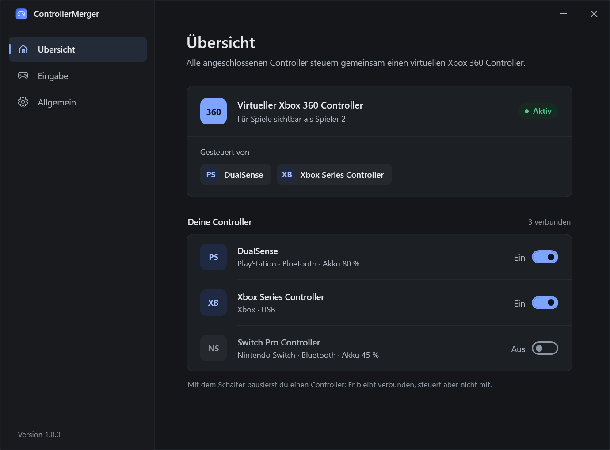

# ControllerMerger

**Alle Gamepads als ein einziger Xbox 360 Controller.** ControllerMerger erzeugt über ViGEmBus dauerhaft einen virtuellen Xbox-360-Controller und führt die Eingaben aller angeschlossenen Controller darauf zusammen. Ideal, wenn du einem Kind am zweiten Controller helfen willst: Beide steuern gleichzeitig dieselbe Spielfigur.



## Funktionen

- **Immer da:** Der virtuelle Xbox 360 Controller existiert dauerhaft, auch ohne angeschlossenen physischen Controller.
- **Vollautomatisch:** Neue Controller werden per Hotplug sofort erkannt und übernommen, eine Zuweisung ist nicht nötig.
- **Echtes Merging:**
  - Tasten: logisches ODER
  - Trigger: der stärkere Wert gewinnt
  - Analog-Sticks: größter Ausschlag, wahlweise *Ganzer Stick* (Standard) oder *Einzelne Achsen*
  - Steuerkreuz: ODER, gegensätzliche Richtungen heben sich auf
  - Totzone für Sticks und Trigger, wird pro Controller vor dem Merge angewendet, damit Drift eines unbenutzten Controllers nie gewinnt
- **Vibration** aus Spielen geht an alle aktiven Controller.
- **Einzelne Controller pausieren:** Sie bleiben verbunden, steuern aber nicht mit.
- **Unterstützt** werden XInput (Xbox 360/One/Series), DualShock 4, DualSense, Switch Pro, Joy-Cons, generische DirectInput-/HID-Gamepads sowie Switch-2-Controller (experimentell, siehe unten).
- **Niedrige Latenz:** Abfrage alle 1, 2, 4 (Standard) oder 8 ms über einen hochauflösenden Timer, bei gemessen ≈ 0,03 % CPU im Leerlauf.
- **Tray-App:** Rechtsklick zeigt den Status, Doppelklick öffnet die Einstellungen. Hell- und Dunkelmodus folgen Windows.
- **Autostart** lässt sich in den Einstellungen aktivieren.

## Installation (für Nutzer)

1. `ControllerMerger.exe` an einen festen Ort kopieren, z. B. `%LOCALAPPDATA%\Programs\ControllerMerger\`. Eine .NET-Installation ist nicht nötig.
2. Starten. Beim **ersten Start** prüft der Assistent, ob der Treiber **ViGEmBus** vorhanden ist. Fehlt er, wird er
   - von GitHub heruntergeladen (fest gepinnte Version **1.22.0**),
   - per **SHA-256 und digitaler Signatur** (Nefarius Software Solutions e.U.) geprüft,
   - mit Administratorrechten installiert (Windows fragt nach).
3. Falls Windows einen Neustart verlangt, startet ControllerMerger danach automatisch wieder.
4. Fertig: Das Symbol erscheint im Infobereich der Taskleiste.

Fehlt der Treiber bei einem späteren Start oder ist er beschädigt, öffnet sich eine Reparaturansicht mit Lösungsschritten.

## Bedienung

| Aktion | Wirkung |
|---|---|
| **Rechtsklick** auf das Tray-Symbol | Status-Popup: virtueller Controller, verbundene Controller, „Beenden“ |
| **Doppelklick** auf das Tray-Symbol | Einstellungen |
| Zweiter Start der EXE | öffnet die Einstellungen der laufenden Instanz |

**Tray-Symbol:** Ein gefüllter grüner Punkt heißt „Controller steuern mit“, ein Ring heißt „bereit, kein aktiver Controller“, ein roter Punkt mit „!“ zeigt ein Problem an, etwa einen fehlenden Treiber.

### Einstellungen

| Seite | Einstellungen |
|---|---|
| Übersicht | Status des virtuellen Controllers, „Gesteuert von“, Liste aller Controller mit Schalter zum Pausieren |
| Eingabe | Stick-Zusammenführung, Totzone (Sticks/Trigger), Achsen umkehren, Abfrageintervall |
| Allgemein | Vibration weitergeben, Mit Windows starten, Farbschema, technische Details, Hilfe, Logdatei |

Die Einstellungen liegen in `%APPDATA%\ControllerMerger\settings.json`, das Log in `%LOCALAPPDATA%\ControllerMerger\log.txt`.

## Bauen (für Entwickler)

**Voraussetzungen:** Windows 10/11 x64 und das [.NET 10 SDK](https://dotnet.microsoft.com/download).

```bash
dotnet build ControllerMerger.sln
```

```bash
dotnet test tests/ControllerMerger.Tests
```

```bash
dotnet publish src/ControllerMerger -c Release -o artifacts/publish
```

Das Ergebnis ist `artifacts/publish/ControllerMerger.exe`: eine self-contained Single-File-EXE (≈ 73 MB, komprimiert), die SDL3 bereits enthält.

### Entwickler-Modi

```bash
ControllerMerger.exe --snapshot artifacts/snapshots
```
Rendert alle Oberflächen in Hell und Dunkel als PNG, ohne Treiber oder Controller. Diese Grundlage nutzte der Design-Council.

```bash
ControllerMerger.exe --export-icon src/ControllerMerger/Assets/AppIcon.ico
```
Erzeugt das App-Symbol neu.

### SDL aktualisieren

SDL 3.4.20 (offizielles Release, zlib-Lizenz) liegt unter `lib/SDL3`. Für ein Update `$Version` und `$Sha256` in `tools/fetch-sdl.ps1` anpassen und das Skript ausführen:

```bash
powershell -ExecutionPolicy Bypass -File tools/fetch-sdl.ps1
```

## Fehlerbehebung

| Problem | Lösung |
|---|---|
| **Ein Spiel reagiert doppelt** | Das Spiel sieht neben dem virtuellen auch die echten Controller. Wähle im Spiel den virtuellen Xbox 360 Controller. Hilft das nicht, verbirg die echten Controller mit [HidHide](https://github.com/nefarius/HidHide). |
| PS-/Switch-Controller wird nicht erkannt, während Steam läuft | Steam Input oder DS4Windows können den Controller exklusiv belegen. Deaktiviere Steam Input für das Gerät oder beende das andere Tool. |
| „Der Controller-Treiber läuft nicht“ | Windows neu starten. Danach den Treiber über den Assistenten neu installieren und prüfen, ob die Speicher-Integrität oder ein Virenscanner ihn blockiert. |
| Mehr als 3 Xbox-Controller | XInput kennt nur 4 Slots, und der virtuelle Controller belegt einen davon. |
| SmartScreen-Warnung | Die EXE ist nicht signiert. Für eine Verteilung wird Code-Signing empfohlen. |

### Switch-2-Controller
SDL 3.4 enthält einen HIDAPI-Treiber für Switch-2-Controller (ControllerMerger aktiviert ihn). Laut SDL-Release-Notes setzt die kabelgebundene Unterstützung libusb voraus, unter Windows also eine `libusb-1.0.dll` neben der EXE und einen WinUSB-Treiber für das Gerät. Mangels Hardware ist das ungetestet, die Unterstützung gilt daher als **experimentell**.

## Architektur & Entscheidungen

- [Architektur](docs/ARCHITECTURE.md): Threads, Datenfluss, Schutz vor dem Feedback-Loop, Erweiterbarkeit
- [Architektur-Council](docs/council/architecture-council.md): Sprache, Bibliotheken, UI-Framework, Distribution und Sicherheit, jeweils mit Bewertungen
- [Design-Council](docs/council/design-council.md): drei Iterationsrunden bis 9/10 bei allen Mitgliedern

**Kurzfassung:**
- **C# / .NET 10 + WPF:** Nefarius.ViGEm.Client ist die Referenz-Implementierung, WPF ermöglicht ein vollständig eigenes Design-System.
- **SDL3 über eine eigene, schlanke P/Invoke-Schicht:** breiteste Controller-Unterstützung (HIDAPI für PlayStation und Switch), volle Kontrolle über Hints und Version.
- **Dedizierter Input-Thread** mit MMCSS, hochauflösendem Timer und allokationsfreiem Hot-Path.
- **Self-contained Single-File:** Endnutzer brauchen nichts außer der EXE.

## Drittanbieter-Komponenten

| Komponente | Lizenz |
|---|---|
| [SDL 3](https://libsdl.org) | zlib |
| [Nefarius.ViGEm.Client](https://github.com/nefarius/ViGEm.NET) | MIT |
| [Hardcodet.NotifyIcon.Wpf](https://github.com/hardcodet/wpf-notifyicon) | MIT |
| [ViGEmBus](https://github.com/nefarius/ViGEmBus) (wird zur Laufzeit installiert, nicht mitgeliefert) | BSD-3-Clause |
