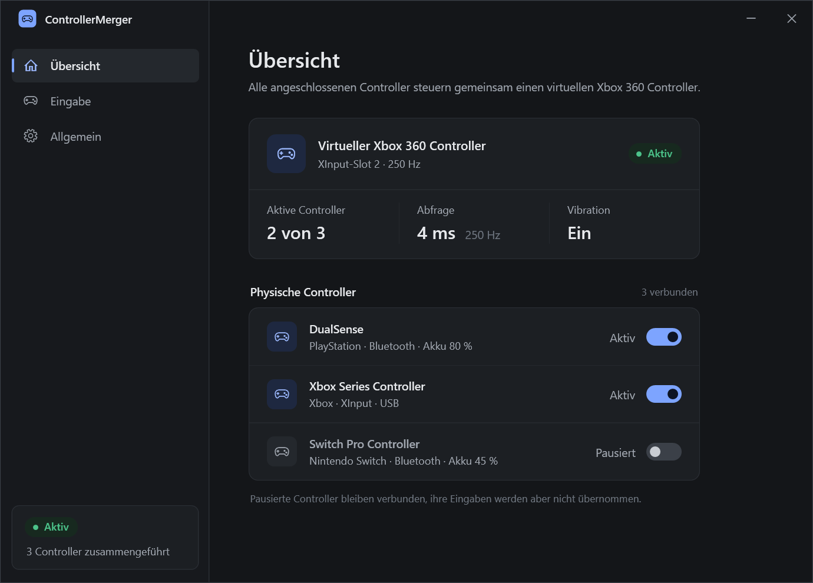
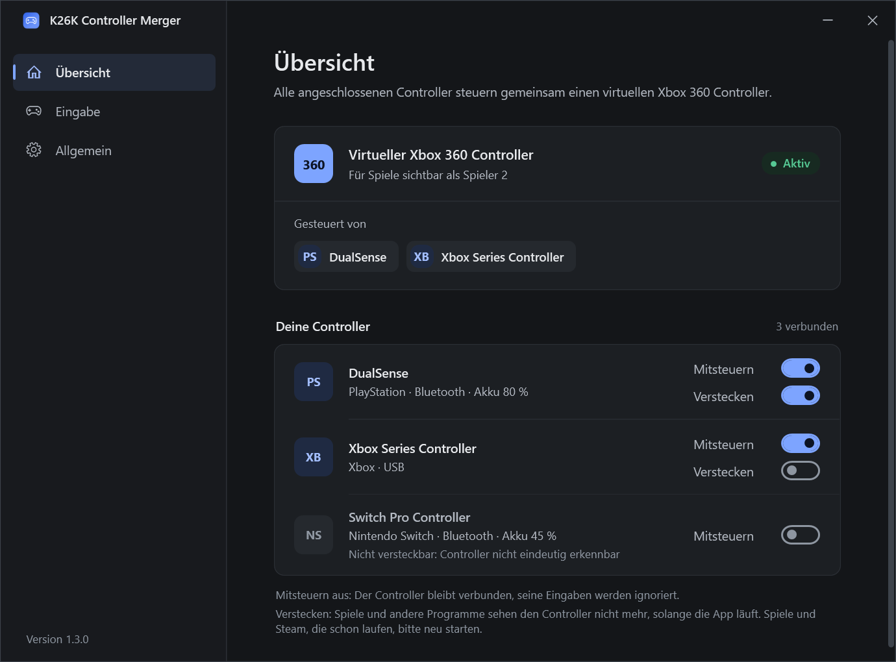

# K26K Controller Merger 1.0: one virtual Xbox 360 controller, every gamepad merged in

## Summary

This change adds a tray tool for Windows 10/11 x64. It permanently creates **one** virtual Xbox 360 controller via **ViGEmBus** and merges the input of **every** connected gamepad into it: Xbox, DualShock 4, DualSense, Switch Pro, Joy-Cons, HID/DirectInput, and Switch 2 (experimental). Two people can then steer one character at the same time, for example a parent helping a child.

## What's included

| Area | Implementation |
|---|---|
| Engine | Dedicated input thread (MMCSS "Games", high-resolution waitable timer, 1/2/4/8 ms), allocation-free hot path, reports sent only on change |
| Merging | Buttons OR, triggers max, sticks largest deflection (*whole stick* / *individual axes*), SOCD-cleaned d-pad, per-input dead zone, axis inversion |
| Input | SDL 3.4.20 (official, pinned) through a custom `LibraryImport` layer; hot-plug via events |
| Output | Nefarius.ViGEm.Client; automatic reconnect; rumble forwarded to all active controllers |
| Feedback-loop protection | XInput backend enforced, own slot (`UserIndex`) filtered out, quarantine until the slot is known; verified in the log |
| First-run setup | Wizard: download ViGEmBus 1.22.0 → SHA-256 + Authenticode (pinned publisher) → elevated install → verification → restart with automatic relaunch if needed |
| UI | Tray (right-click status popup, double-click settings), custom design system with light/dark following Windows, German/English switchable live |
| Settings | Dead zone, stick mode, invert axes, polling interval, rumble, autostart, color scheme, pause individual controllers |
| Quality | 20 unit tests (merge logic, settings), structured logging, atomic settings writes, single instance |
| Distribution | Self-contained single-file EXE (≈ 73 MB compressed), no .NET install needed |
| License | GNU AGPL v3.0 |

## Decision process

### Architecture council (Claude Opus · Sonnet · Haiku)
Full record with all scores: [`docs/council/architecture-council.md`](council/architecture-council.md)

- **C# / .NET 10** (unanimous; 8/9/9), ahead of Rust (4–5) and C++ (3–6)
- **SDL3** (unanimous; 9), ahead of Windows.Gaming.Input and custom HID parsers
- **Custom P/Invoke layer** (8 vs. 7). Confirmed when it turned out that ppy.SDL3-CS ships an SDL 3.5 development build
- **WPF + Hardcodet** (9/9/8; tray 2:1)
- **Self-contained single file** (unanimous)
- **Installer security:** version, SHA-256 and signer pinned (unanimous)

### Feature decisions (made by the user)
- No HidHide; a hint in the settings and the README instead
- Stick merge mode switchable, default *whole stick*
- Individual controllers can be paused (no per-controller settings, no live view, no connection notifications)
- German and English UI (switchable in the settings); English README and docs

### Design council (Claude Opus · Sonnet · Haiku · Fable)
Process and all rounds: [`docs/council/design-council.md`](council/design-council.md)

| Round | Opus | Sonnet | Haiku | Fable |
|---|---|---|---|---|
| 1 | 7 | 7 | 6 | 6 |
| 2 | 8 | 8.5 | 8 | 8 |
| **3** | **9** | **9** | **9** | **9** |

| Before (R1) | After (R3) |
|---|---|
|  |  |

## Verification

- `dotnet test`: **20/20 passed**
- Build with no warnings
- Smoke test against an installed ViGEmBus (debug and release single-file):
  - virtual controller takes XInput slot 1
  - SDL sees it as `XInput=True/0, self=True`, so the own pad is correctly filtered out
  - polling at 250 Hz (4 ms, high-resolution timer)
  - about 0.03 % CPU when idle, about 78 MB working set
- `--snapshot` renders all 27 views/states in light and dark mode without errors

### Not verified (no hardware on the test machine)
- Merging and rumble with **real** physical controllers (none was connected to the test machine)
- The setup wizard's full install path (ViGEmBus was already installed; download, hash and signature were checked separately against the original file)
- Switch 2 controllers

## Open items / backlog
- Design suggestions for 10/10 (see [round 3](council/design/round-3.md))
- Code signing the EXE to avoid SmartScreen warnings

🤖 Generated with [Claude Code](https://claude.com/claude-code)
