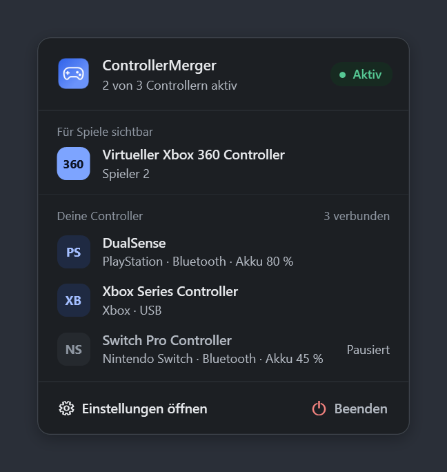

# Design-Council – Prozess & Ergebnis

## Auftrag
Die Oberfläche (Tray-Popup, Einstellungsfenster, Einrichtungsassistent, Tray-Symbol) iterativ verbessern, bis **jedes** Council-Mitglied mindestens **9/10** für die Designqualität vergibt. Ziel war ein modernes, ruhiges, augenschonendes UI mit gleichwertigem Hell- und Dunkelmodus, das kein generischer Windows-Standard-Look ist.

## Zusammensetzung
Vier Claude-Modelle mit festen, sich ergänzenden Rollen. Jedes Mitglied bewertete unabhängig und wurde in den Folgerunden mit seinem eigenen Verlauf fortgesetzt, damit es gezielt prüfen konnte, ob *seine* Kritik gelöst ist.

| Mitglied | Rolle | Schwerpunkt |
|---|---|---|
| Claude Opus | Senior Visual Designer | Ästhetik, Typografie, Raster, Hierarchie, Konsistenz |
| Claude Sonnet | UX & Informationsarchitektur | Verständlichkeit, Microcopy, Zustände, Bedienlogik |
| Claude Haiku | Accessibility & Augenkomfort | WCAG-Kontrast, Farbunabhängigkeit, Klickziele, Blendung |
| Claude Fable | Kritischer Product-Design-Lead | Vergleich mit Top-Utilities, Charakter, Redundanz |

## Methode
1. **Reproduzierbare Renderings:** `ControllerMerger.exe --snapshot <ordner>` rendert alle Oberflächen mit Beispieldaten in Hell und Dunkel (1,5-fach) als PNG, darunter Normal-, Leer-, Fehler-, Setup- und Tray-Zustände. Dafür braucht es weder Treiber noch Controller.
2. **Unabhängige Bewertung:** festes Antwortformat (Score, Stärken, Probleme mit konkretem Fix, „für 9/10 nötig“).
3. **Konsolidierung:** Überschneidende Kritik wurde zu Maßnahmen zusammengeführt. Bei Zielkonflikten (z. B. „Beenden“ rot vs. neutral) wurde ein Kompromiss gewählt und dokumentiert.
4. **Umsetzung → neue Renderings → nächste Runde.**

## Verlauf

| Runde | Opus | Sonnet | Haiku | Fable | Kernthemen |
|---|---|---|---|---|---|
| [1](design/round-1.md) | 7 | 7 | 6 | 6 | widersprüchliche Zustände, Dopplungen, Jargon, Breiten, Kontrast, kein Charakter |
| [2](design/round-2.md) | 8 | 8,5 | 8 | 8 | Button-Hierarchie, leerer Erfolgsdialog, Symbolik App vs. virtueller Controller, Tray bei 16 px |
| [3](design/round-3.md) | **9** | **9** | **9** | **9** | ✅ Abbruchkriterium erreicht |

## Wichtigste Designentscheidungen (Ergebnis)

- **Design-Tokens statt Einzelfarben:** `Themes/Dark.xaml` und `Themes/Light.xaml` mit identischen Schlüsseln. Alle Controls nutzen ausschließlich `DynamicResource`, der Wechsel zwischen Hell und Dunkel erfolgt live und folgt auf Wunsch Windows.
- **Augenschonendes Dunkel:** kühles Neutralgrau (#141619 / #1C1F23) statt Reinschwarz, eine einzige Akzentfarbe, semantische Farben nur für Zustände.
- **Kontrast nach WCAG:** Tertiärtext ≥ 5,3:1, Nicht-Text-Elemente (Schalter-Aus, Slider-Track, Segment- und Navigationsauswahl) ≥ 3:1.
- **Zustand nie nur über Farbe:** Schalterposition + „Ein/Aus“, Badges mit Punkt + Text; das Tray-Symbol kodiert über die Form (Punkt / Ring / Ausrufezeichen).
- **Jede Information genau einmal:** keine Kennzahl-Kacheln, kein doppeltes „Aktiv“, Technik gesammelt in „Technische Details“.
- **Ehrliche Zustände:** Aktiv / Bereit / Pausiert / Fehler. Ein Fehler hat genau eine Meldung und eine Handlung („Treiber einrichten“).
- **Eigene Zeichensprache:** Monogramm-Kacheln (PS, XB, NS, NS2, GC), der virtuelle Controller als „360“, Hero „Gesteuert von …“ (N → 1).
- **Laiensprache:** „Für Spiele sichtbar als Spieler 2“ statt „XInput-Slot 1“, Totzone, Vibration, Tasten, „Ganzer Stick / Einzelne Achsen“.
- **Raster:** 4-px-Basis, 40-DIP-Kacheln mit 16 DIP Abstand, eine Fluchtlinie für Text, eine Inhaltsbreite (600 DIP) für alle Seiten, Radius 6 / 10 / 12.
- **Setup wie ein Produkt:** feste Höhe, Fußleiste, Stepper mit Linien, Wartezustand mit Spinner und „Schritt 2 von 3“, Erfolgskarte mit den zwei Tray-Gesten, Reparatur als „Das hilft meistens“.

## Vorher / Nachher

| Runde 1 | Runde 3 |
|---|---|
|  |  |
|  |  |

Alle finalen Renderings liegen unter [`docs/design/screenshots`](../design/screenshots).
