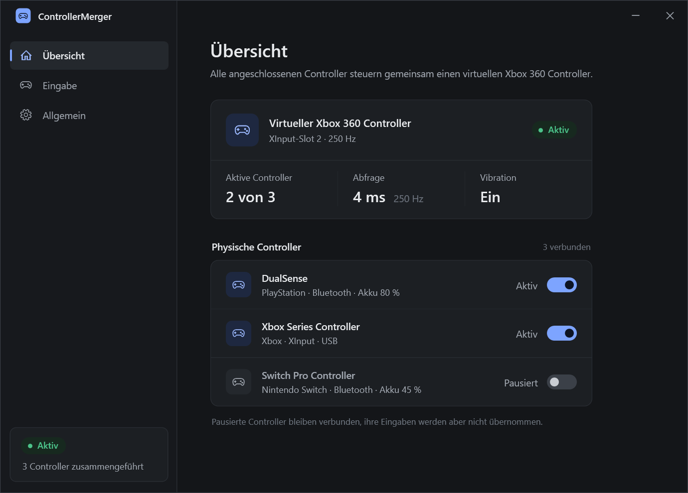
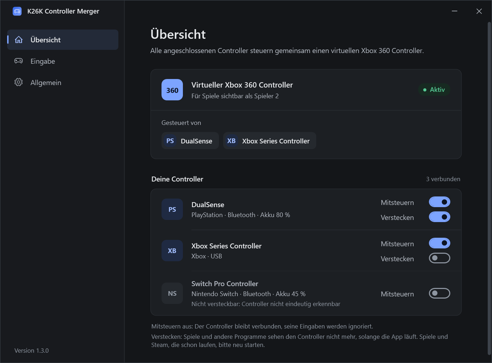
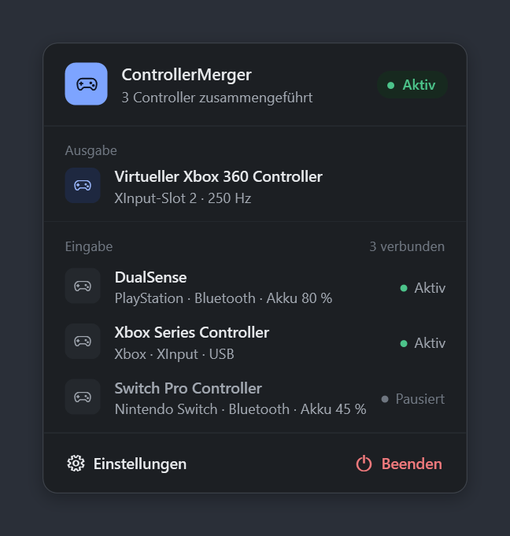

# Design council – process & result

## Mandate
Iteratively improve the interface (tray popup, settings window, setup wizard, tray icon) until **every** council member rates the design quality at least **9/10**. The goal was a modern, calm, eye-friendly UI with equally good light and dark modes, not a generic Windows default look.

## Members
Four Claude models with fixed, complementary roles. Each member rated independently and was resumed with its own history in later rounds, so it could check specifically whether *its* criticism had been addressed.

| Member | Role | Focus |
|---|---|---|
| Claude Opus | Senior visual designer | Aesthetics, typography, grid, hierarchy, consistency |
| Claude Sonnet | UX & information architecture | Clarity, microcopy, states, interaction logic |
| Claude Haiku | Accessibility & eye comfort | WCAG contrast, color independence, click targets, glare |
| Claude Fable | Critical product design lead | Comparison with top utilities, character, redundancy |

## Method
1. **Reproducible renderings:** `K26KControllerMerger.exe --snapshot <folder>` renders every screen with sample data in light and dark mode (1.5×) as PNG, including normal, empty, error, setup and tray states. No driver or controller is needed.
2. **Independent rating:** fixed answer format (score, strengths, problems with a concrete fix, "needed for 9/10").
3. **Consolidation:** overlapping criticism was merged into actions. On conflicting goals (e.g. "Quit" red vs. neutral), a compromise was chosen and documented.
4. **Implementation → new renderings → next round.**

## History

| Round | Opus | Sonnet | Haiku | Fable | Key topics |
|---|---|---|---|---|---|
| [1](design/round-1.md) | 7 | 7 | 6 | 6 | contradictory states, duplication, jargon, widths, contrast, no character |
| [2](design/round-2.md) | 8 | 8.5 | 8 | 8 | button hierarchy, empty success dialog, app vs. virtual-controller symbols, tray at 16 px |
| [3](design/round-3.md) | **9** | **9** | **9** | **9** | exit criterion reached |

Version 1.3 (hiding controllers) went through two more rounds until every member rated 9/10 again: [v1.3-hide-controllers.md](v1.3-hide-controllers.md).

The council reviewed the German UI. The English translation added later uses the same layout and was checked via `--snapshot` (files prefixed `en-`).

## Key design decisions (result)

- **Design tokens instead of individual colors:** `Themes/Dark.xaml` and `Themes/Light.xaml` with identical keys. All controls use `DynamicResource` only, and switching between light and dark happens live, optionally following Windows.
- **Eye-friendly dark:** cool neutral gray (#141619 / #1C1F23) instead of pure black, a single accent color, semantic colors only for states.
- **WCAG contrast:** tertiary text ≥ 5.3:1, non-text elements (switch off-state, slider track, segment and navigation selection) ≥ 3:1.
- **State never by color alone:** switch position + "On/Off", badges with dot + text; the tray icon also encodes state by shape (dot / ring / exclamation mark).
- **Every piece of information exactly once:** no metric tiles, no duplicate "Active", technical information collected under "Technical details".
- **Honest states:** Active / Ready / Paused / Error. An error shows exactly one message and one action ("Set up driver").
- **Own visual language:** monogram tiles (PS, XB, NS, NS2, GC), the virtual controller as "360", and a hero showing "Controlled by …" (N → 1).
- **Plain language:** "Visible to games as player 2" instead of "XInput slot 1", dead zone, rumble, buttons, "whole stick / individual axes".
- **Grid:** 4 px base, 40 DIP tiles with 16 DIP spacing, one alignment line for text, one content width (600 DIP) for all pages, radii 6 / 10 / 12.
- **Setup like a product:**
  - fixed height and a footer
  - stepper with connecting lines
  - waiting state with spinner and "Step 2 of 3"
  - success card showing the two tray gestures
  - repair view as "What usually helps"

## Before / after

| Round 1 | Round 3 |
|---|---|
|  |  |
|  |  |

All final renderings are in [`docs/design/screenshots`](../design/screenshots).
